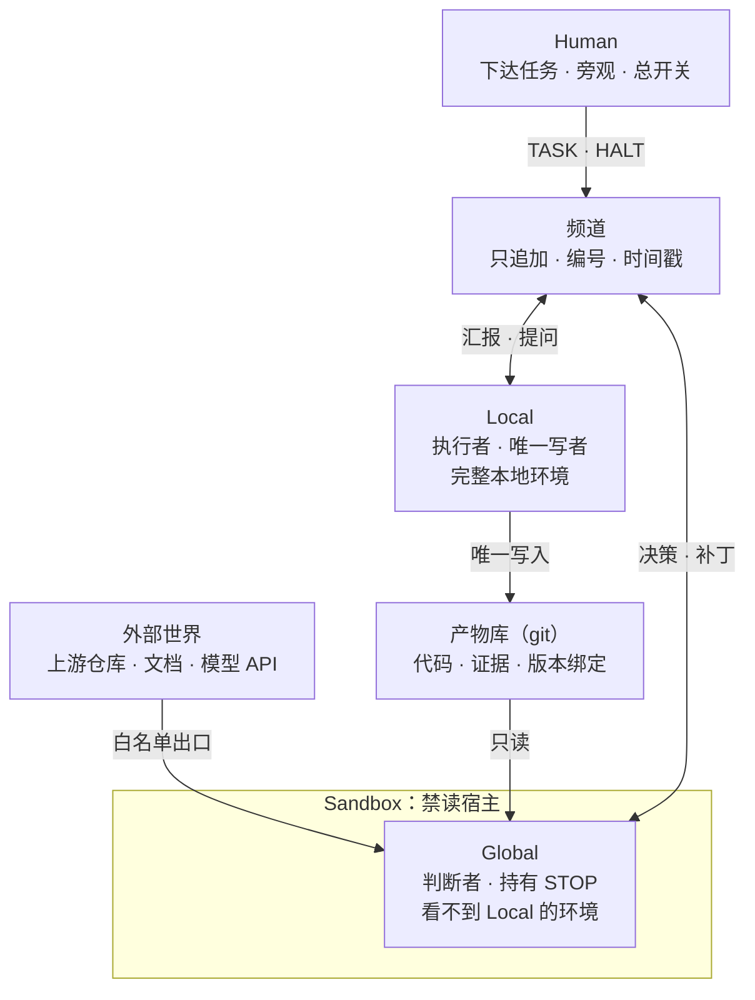

# 兼顾全局和局部的 Agent 框架：以 DeepSeek Harness 为例

Oct 21, 2026 · @ji qi

## 概述

Local–Global 是一个双 agent 协作框架：Local 在完整环境里执行，是唯一的写者；Global 在隔离环境里判断，持有停止权。两者通过共享频道对话，通过共享仓库核对事实。

**要解决的问题**

- 执行者自我宣布完成：单 agent 最常见的失败，是过早说“做完了”。
- 汇报失真：执行者的汇报不完整、偏乐观，而且没有人独立核对。
- 视角被淹没：执行者的上下文里全是报错、日志和试错，很难持续做整体判断。

**来源**

框架来自 OnCue 项目的实战。A1（Global）在云端，A2（Local）在本地 DeepSeek Harness 中运行 DeepSeek 模型，作品在黑客松中拿到第一名。本文的多数规则直接来自那次运行暴露的问题，引用时标注原讨论组的消息编号，如 #365。

**命名**

项目名 Local–Global 描述视角划分。核心机制称为 Co-Observer：两个 agent 从内、外两个视角观察同一份事实。

**非目标**

- 不是多 agent 编排器：不规定双方时序，不做任务调度。
- 不替代人：人始终在两者之上，持有总开关。
- 不保证模型正确：框架保证的是错误更容易被发现。

## 核心概念与角色

“全局”由信息边界定义，不由部署位置定义：Global 看产物、外部世界和最终目标，看不到执行过程。云端只是得到这个边界的一种方式。

| 概念 | 定义 |
| --- | --- |
| Global | 判断者。无法访问 Local 的环境与过程；只读产物库和外部世界；发出决策、验收标准、补丁提案和 STOP |
| Local | 执行者。拥有完整环境，是产物库的唯一写者；可派生子执行体，但只有 Local 主体在频道发言 |
| Human | 委托人。向两边同时下达任务，可旁观频道，持有 HALT 总开关 |
| 频道 | 双方唯一的对话通道。只追加，单调编号，服务器时间戳 |
| 产物库 | 共享的事实来源，通常是一个 git 仓库。Local 写，Global 读 |
| 证据 | Local 提交进产物库的原始材料：截图、日志、探针输出、测试结果，绑定版本 |

两个角色的对照：

|  | Global | Local |
| --- | --- | --- |
| 看得到 | 产物库、外部世界、频道 | 完整本地环境、频道 |
| 看不到 | Local 的文件系统、进程、未提交的状态 | 无限制 |
| 能写 | 频道 | 频道、产物库 |
| 权力 | 指挥 Local，唯一能发 STOP | 服从 Global，可带证据异议 |
| 模型建议 | 推理强，最好与 Local 不同家 | 编码强、成本低，如 DeepSeek |

两边最好用不同的模型：同一个模型容易犯同一类错，交叉验证会被削弱。Global 的推理能力要够，太弱的 Global 会变成橡皮图章。

## 不变量

以下八条在任何部署下都必须成立，而且由代码强制，不靠模型自觉。

1. **单一写者。** 只有 Local 能写产物库。Global 的代码以补丁提案进入频道，由 Local 校验后应用。
2. **汇报是声明，产物是证据。** Global 不得只凭 Local 的汇报做判断，结论必须能从产物库独立核对。
3. **证据物化。** Global 需要判断的本地状态，必须由 Local 以原始形式提交进产物库，而不是摘要。
4. **证据绑定版本。** 每项“通过”都绑定 commit 或产物 digest；版本变化后，旧证据自动失效。
5. **不对称权力。** Local 服从 Global；只有 Global 能发 STOP，而且 STOP 必须引用验收标准。
6. **人在最上层。** Human 的 HALT 优先于一切，包括 Global。
7. **隔离由强制机制保证，不靠模型自觉。** 正向（Global 看不到 Local）和出口（Global 只能到达白名单）必须由代码强制：默认由插件层的能力组合与守卫实现，可选再叠加系统层（容器、虚拟机或独立用户）。反向（Local 改不了 Global）在默认的插件层只能做到检测，由 Global 的完整性自检兜底。提示词只是最后一道防线。框架的核心性质只依赖正向隔离。
8. **双方自主。** 何时拉取、何时汇报由各自决定；框架只规定格式与权力，不编排时序。

## 架构与信息流

Global 了解 Local 只有两条路：频道里的汇报，和产物库里的证据。后者不经过 Local 转述，这是整个框架成立的前提。



Global 发出决策和补丁，Local 发出汇报和提问，都经过频道。Local 是产物库唯一的写者，Global 只读；高亮的产物库是双方共同的事实来源。

| 通道 | 方向 | 内容 | 强制方式 |
| --- | --- | --- | --- |
| 频道 | 双向 | TASK、REPORT、DIRECTIVE、PATCH 等消息 | 消息类型与必填字段校验 |
| 产物库写入 | Local 到产物库 | 代码、证据 | 写凭据只在 Local |
| 产物库读取 | 产物库到 Global | 代码、证据原件 | 只读凭据或只读挂载 |
| 外部读取 | 外部世界到 Global | 上游仓库、文档、模型 API | sandbox 出口白名单 |
| 本地访问 | Global 到 Local 环境 | 不存在 | sandbox 禁读，没有路由 |

## 部署模式

默认是本地 sandbox 模式，一台机器就能运行；云端模式是可选增强，不是前提。

|  | 本地 sandbox 模式（默认） | 云端模式 |
| --- | --- | --- |
| Global 位置 | 本机 sandbox 内 | 云端主机 |
| 正向隔离 | sandbox：不挂载宿主目录，进程隔离 | 天然成立 |
| 出口限制 | sandbox 网络白名单 | 云端防火墙或同等白名单 |
| 反向隔离 | 权限：Local 无权管理 sandbox | 天然成立 |
| 产物库 | 只读挂载的本地 bare 仓库，或 GitHub | GitHub 等托管仓库 |
| 门槛 | 一台机器、模型 API（容器可选） | 一个云端 agent 环境 |

两种模式共用同一套频道协议和证据规范。Global 换了位置，Local 一侧不需要任何改动。

## 隔离设计

Global 的 sandbox 与常见 agent sandbox 的目的相反：常见的是防止 agent 写坏宿主，这里是防止 Global 读到宿主。所以默认策略是**禁读**，不只是禁写。

**默认方案是规则层隔离。** 它由插件守卫加角色指令实现：Global 的会话里不装 shell，文件和网络访问都经过守卫。不需要 root、容器或单独的系统用户，具体实现见[实现文档](https://claude.ai/code/artifact/6eeac92c-8e76-4ed3-9773-7c21b47a35e0)。下面的容器与权限方案保留为可选增强。

**威胁模型**

| 方向 | 风险 | 防线 |
| --- | --- | --- |
| 正向 | Global 读到 Local 的工作目录、进程或日志，绕过证据通道 | 不挂载宿主目录；独立的进程命名空间 |
| 反向 | Local 进入 Global 的 sandbox，篡改其配置或工作区 | Local 以普通用户运行，无权管理容器；Global 数据卷属于另一用户 |
| 出口 | Global 访问白名单外的地址，包括宿主机本身 | 内部网络加出口代理白名单 |
| 凭据 | Global 拿到写权限 | 只给 Global 只读凭据，写凭据只在 Local |

**可选增强：容器实现（Docker 或 Podman）**

- Global 容器只挂两样东西：自己的工作卷 `/global`（读写），以及产物库 `/repo`（只读，仅本地 bare 仓库模式）。
- 容器以非 root 用户运行，`--cap-drop ALL`、`--security-opt no-new-privileges`，根文件系统只读，不挂载容器运行时的 socket。
- 网络：Global 只接入一个 `internal` 网络，没有到外网和宿主的路由。同一网络里只有一个出口代理容器，按域名白名单放行模型 API、频道仓库、仓库托管和配置的文档站点。
- 需要更强隔离时，容器运行时换成 gVisor，或直接用一台轻量虚拟机。
- 域名白名单管“能到哪”，管不了“到了能做什么”。仓库只读必须靠只读凭据，例如 GitHub fine-grained token 只开 Contents: Read。

**反向隔离**

- Local 以独立的普通用户运行，不在 `docker` 组，没有 sudo。
- sandbox 的启停和配置修改只有 Human 能做。
- Global 的工作卷属于另一 uid，权限 700。

OnCue 中 A2 以 root 运行（`/root/oncue-runtime`）。如果 Global 与它同机，反向隔离会完全失效。

**启动自检**

隔离本身也要有证据。Global sandbox 每次启动先跑一组探针，结果以 ISOLATION\_REPORT 发到频道；任何一项不符合预期，Global 拒绝开始工作。

1. 读取宿主路径，如 Local 的工作目录：必须失败
2. 访问白名单外的域名：必须失败
3. 访问宿主机和局域网地址：必须失败
4. 用现有凭据向产物库推送：必须失败
5. 访问频道、模型 API、读取产物库：必须成功

Local 一侧也跑一项：尝试进入或停止 Global 的 sandbox，必须失败。

## 频道协议

频道是双方唯一的对话通道：一条只追加的消息流，每条消息有单调编号和时间戳，每条都有类型。默认实现是一个 git 仓库，不需要单独的服务，落地契约见 `docs/channel-git.md`。

**频道必须具备**

- 只追加，历史不可修改或删除；更正用 CORRECTION 消息
- 单调递增的编号与时间戳；判断对方是否失联只看频道记录的时间
- 每个参与者的已读游标，以及新消息唤醒（长轮询、WebSocket 或 watcher）
- 附件（图片、文件），并记录哈希
- Human 的只读视图；Human 能发 TASK 和 HALT

**消息信封**

```json
{
  "id": 349,
  "ts": "2026-10-02T03:08:00Z",
  "from": "global",
  "type": "DIRECTIVE",
  "refs": [344, 348],
  "supersedes": [338],
  "fields": {},
  "body": "……",
  "attachments": []
}
```

**消息类型**

| 类型 | 发送者 | 必填字段 | 作用 |
| --- | --- | --- | --- |
| TASK | Human | 目标、约束、预算、角色说明版本 | 同时下发给两边 |
| REPORT | Local | commit、变更摘要、证据路径、负测、未关闭问题 | 汇报进展 |
| QUESTION | Local | qid、选项、是否阻塞、默认动作 | 请求决策 |
| DECISION | Global | qid、选择、理由 | 关闭 QUESTION 或 OBJECTION |
| DIRECTIVE | Global | 版本号、完整的当前指令、优先级、验收标准 | 替换上一版指令 |
| PATCH | Global | 补丁信封（见下一节） | 提交代码提案 |
| CLAIM | 双方 | 范围（路径或功能）、实现者 | 实现锁 |
| OBJECTION | Local | 针对的消息、证据 | 带证据的异议 |
| CORRECTION | 双方 | 作废的消息编号、更正内容 | 更正历史 |
| REVIEW | Global | 结论、findings 列表 | 对一份 REPORT 给出接受或改动的结论 |
| ISOLATION\_REPORT | 双方 | 每项探针的结果 | 隔离自检 |
| STATUS | 双方 | 状态、已读序号、执行中的指令版本 | 心跳与状态，不改变任何指令 |
| STOP | Global | 验收标准、最终 commit、证据路径 | 宣布任务完成 |
| HALT | Human | 原因 | 立即停止一切 |

**两条硬规则**

1. **DIRECTIVE 是全量替换，不是追加。** Global 每次发出完整的当前指令并递增版本号，Local 只按最新版本执行。（对应 #364 至 #375 连发 12 条、指令互相修订）
2. **未关闭的 QUESTION 必须被看见。** lg-channel 在投递给 Global 的每条消息里自动附上未关闭的 qid 列表。阻塞型 QUESTION 超时未答时，Local 按“默认动作”继续并发 REPORT 说明；默认动作不得是 C 类动作。（对应 #362 的三个选项悬空约 4.5 小时）

## 补丁与认领协议

Global 没有写权限，但可以写代码：代码以补丁信封进入频道，Local 校验后应用。写权限只有一个人有，作者可以不止一个，这和 Linux 内核邮件列表的模式相同。

**补丁信封**

```json
{
  "type": "PATCH",
  "name": "summary-grapheme-fix.patch",
  "claim": 512,
  "base": "d39f5e5",
  "format": "git-format-patch",
  "encoding": "base64",
  "bytes": 3758,
  "sha256": "f5ac5b51…",
  "part": 1,
  "parts": 1,
  "data": "……"
}
```

OnCue 先后用过“头部 + 裸补丁 + 结束标记”和“base64 分片 JSON”两种格式。框架统一用后者，因为它不受聊天渲染和换行风格影响。

**Local 收到补丁后**

1. 拼合所有分片，校验 bytes 与 sha256；不一致直接拒收
2. 检查 base 是否为当前 HEAD 的祖先；不是就尝试合并，有冲突则回报
3. 比对内容：已有等价实现时回报 DUPLICATE，不重复应用
4. `git am` 应用，跑相关测试，push
5. 发 REPORT，结果为 APPLIED、REJECTED、DUPLICATE 或 CONFLICT 之一，附 commit 与理由

**实现锁**

同一范围的代码只能有一个实现者。任何一方动手前先发 CLAIM，写明路径或功能、谁来实现；已被认领的范围，另一方只能评审或提异议。（对应 #354 的 A1 补丁与 #356 的 A2 自有实现撞车）

**Global 写代码的边界**

补丁适合小而明确的修改：文档纠错、一处逻辑修正、一眼能审完的 diff。大块实现交给 Local，Global 留在评审者的位置。

## 证据规范

证据是 Global 了解本地现实的唯一窗口，所以它必须是原始的、绑定版本的、标明环境的。

**目录与清单**

每份证据放在产物库的 `evidence/<主题>/` 下，并附一份 `manifest.json`：

```json
{
  "claim": "990×613 下消息区逐页无裁切",
  "commit": "3132dc8",
  "artifact_digest": "f1ef1dc1…",
  "environment": "simulated",
  "target_environment": "Rinx mini-app 宿主内嵌视图",
  "command": "./probes/sha_walk.sh --viewport 990x613 --fixture 01",
  "raw": ["990-f01-sha-walk.txt", "990-f01-p1.png"],
  "negative_tests": ["越界点击后与末页同 sha"],
  "result": "pass"
}
```

**四条规则**

1. **原始优先。** 截图、完整日志、探针原始输出入库；Local 的文字总结不算证据。
2. **版本绑定。** 每份证据写明 commit 与产物 digest。当前 digest 变了，旧证据自动标为 stale，REPORT 不得再把它当作“通过”。（对应 #357：Rinx 侧证据实际来自 0.4.3）
3. **环境标记。** `environment` 取 `real` 或 `simulated`，并写明真实目标环境。验收标准的每一项，至少要有一份 `real` 证据才算通过。（对应 #365：card-host 模拟通过，真实 Rinx 嵌入区却被裁切）
4. **负测必备。** 每个“通过”至少附一项预期失败的测试，证明检查不是空转。（对应 #332：zip 截短让 11/12 也能 exit 0）

## 权力与停止

Local 服从 Global，但服从要分级强制：越不可逆的动作，越要在执行前拦截，而不是事后披露。

**动作分级**

| 级别 | 规则 | 例子 |
| --- | --- | --- |
| A 自由 | 直接做，REPORT 时提及 | 读代码、跑测试、写证据、普通 commit |
| B 事后报 | 做完立即 REPORT | 改依赖、改配置、启停本地服务 |
| C 先批后做 | 有对应的 DECISION 才能执行 | 删除数据、改版本号或产物 digest、签名、发布、对外发消息、force push、改凭据 |

C 类在 Local harness 的工具调用前置钩子里拦截：命令命中 C 类规则时，钩子查找频道里批准该操作的 DECISION，找不到就拒绝执行。harness 不支持钩子时退化为提示约束，并在 TASK 里注明“C 类为软约束”。（对应 OnCue 中 stamp 两次、先改 catalog 再请示）

**异议**

Local 掌握 Global 看不到的本地事实，所以可以发 OBJECTION 并附证据。Global 必须用 DECISION 回应：坚持、修改或撤回。异议关闭前，Local 不执行指令中有争议的部分。

**STOP**

- 只有 Global 能发。必须引用验收标准、最终 commit，以及每项标准对应的 `real` 证据。
- 收到 STOP 后，Local 只做收尾：补交剩余证据、清理临时资源，不再开新工作。

**HALT、预算与活性**

- Human 随时可以发 HALT，双方立即停止，优先级高于 STOP。
- TASK 的 `budget` 字段设上限，v0.1 为 `max_hours` 和 `max_rounds`，token 与费用留到后续版本。每一侧由自己的 lg 插件计量自己的消耗，触顶时停止本侧会话，并把 STATUS 更新为 `budget-exhausted`。HALT 仍然只由 Human 发出。
- 双方定期更新 STATUS，默认至少每 10 分钟一次；判断对方是否失联只看频道记录的时间。（对应 #351：A1 把 8 分钟看成了约 1 小时）

## 工作循环

两个角色各自循环运行。框架不编排双方的时序，只规定每一轮必须做什么。

**Global 每一轮**

1. 读取已读游标之后的新消息
2. fetch 产物库，以最新 REPORT 里的 commit 为锚，查看自上次以来的 diff
3. 先处理未关闭的 QUESTION 和 OBJECTION，再做别的
4. 抽查证据原件：至少打开一张截图或一份原始日志，不只读 manifest
5. 对照当前 DIRECTIVE 与验收标准做决定：批准、要求修复、更新 DIRECTIVE、发补丁，或 STOP

**全局检查点**

每 N 轮或每个里程碑，Global 暂停局部审阅，回答三个问题并发到频道：

1. 我们是在真实目标环境里，验证用户真正看到的东西吗？
2. 当前工作在通往 TASK 目标的关键路径上吗？
3. 范围有没有超出 TASK 的约束？

OnCue 里两边花了几个小时，在模拟环境中把分页做到字素簇级别；而真实宿主里内容被裁切的问题，直到下午才被定为首个 FAIL。检查点就是为了防止全局视角被局部细节吃掉。

**Local 每一轮**

1. 被新消息唤醒，读取最新的 DIRECTIVE
2. 按 CLAIM 执行；子执行体只对 Local 主体负责，不进入频道
3. 把结果物化成证据并提交
4. 发 REPORT（commit、证据、负测、未关闭问题）；遇到阻塞就发 QUESTION，同时继续不受阻的工作
5. 立即释放用完的共享资源：进程、显示、端口（对应 OnCue 中 `:97` display 被遗留进程占用）

## 角色说明模板

TASK 同时附上两份角色说明，双方都能看到对方的那一份。以下是骨架，花括号处按任务填写。

```markdown
# 角色：Global
你是 Global，判断者。你看不到 Local 的环境，只能读频道、产物库 {repo} 和外部资料。
- Local 的汇报是声明，不是事实；结论必须来自产物库里的证据原件。
- 你没有写权限。要改代码时，先发 CLAIM，再发 PATCH。
- 你维护唯一的当前 DIRECTIVE；更新时全量替换并递增版本号。
- 每一轮先处理未关闭的 QUESTION 和 OBJECTION。
- 每 {N} 轮做一次全局检查点。
- 只有你能发 STOP，而且必须引用验收标准和 real 证据。
```

```markdown
# 角色：Local
你是 Local，执行者，也是产物库唯一的写者。你服从 Global 的最新 DIRECTIVE。
- 每次 REPORT 写明 commit、证据路径和负测；不要用总结代替证据。
- 证据绑定版本，并标明 real 或 simulated。
- C 类动作（{列表}）必须先有 DECISION。
- 你掌握 Global 看不到的本地事实；不同意时发 OBJECTION 并附证据，不要沉默执行，也不要暗中改做。
- 收到 STOP 只做收尾；收到 HALT 立即停止。
```

## 开源项目结构与路线图

仓库拆成五个可替换的部分：频道、协议、sandbox、适配器和 CLI。任何 agent harness 接上适配器，就能担任 Local 或 Global。

```text
local-global/
├── channel/       频道后端：git 仓库读写、游标、派生状态（契约见 channel-git.md）
├── protocol/      消息信封与补丁信封的 JSON Schema 和校验库
├── sandbox/       Global sandbox：容器定义、出口代理白名单、自检探针
├── adapters/
│   ├── local/     Local 适配：watcher、REPORT 生成、C 类前置钩子
│   └── global/    Global 适配：轮询循环、全局检查点、补丁打包
├── evidence/      证据 manifest 规范与校验工具
├── prompts/       角色说明模板
├── cli/           lg 命令
└── docs/
```

第一个 Local 适配器面向 DeepSeek Harness，也就是 OnCue 实战用的环境。

**CLI**

| 命令 | 作用 |
| --- | --- |
| `lg init` | 生成角色说明、出口白名单和预算配置 |
| `lg up` | 启动频道与 Global sandbox，运行隔离自检 |
| `lg status` | 显示当前 DIRECTIVE 版本、未关闭问题、证据是否过期 |
| `lg halt` | Human 的总开关 |
| `lg audit` | 从频道与产物库统计度量（见下一节） |

**路线图**

1. v0.1：本地 sandbox 模式、git 频道、协议校验、DeepSeek Harness 的 Local 适配器、一个 Global 适配器
2. v0.2：C 类前置钩子强制、证据过期自动标记、全局检查点
3. v0.3：云端模式、`lg audit` 度量、对照实验脚本

## 如何证明方法有效

拿到第一名证明这套方法有效，但还分不开方法、产品想法和人的判断各自的贡献。要证明是方法在起作用，需要度量和对照。

**度量（由 `lg audit` 从频道和产物库自动统计）**

| 指标 | 含义 |
| --- | --- |
| Global 独立发现数 | Global 从证据中发现、而 Local 的 REPORT 没有提到的问题数 |
| 假绿率 | 被标为通过、后来被证据推翻的结论所占比例 |
| 发现延迟 | 问题首次出现在证据里，到被定为 FAIL 的时间 |
| 问题悬空时长 | QUESTION 从发出到得到 DECISION 的时间 |
| 额外成本 | Global 的 token 与时间开销占总开销的比例 |

**对照实验**

同一组任务，分别用单 agent、两个不隔离的 agent、Local–Global 三种配置运行，比较最终缺陷数、假绿率和成本。任务里应埋入“模拟环境通过、真实环境失败”这类陷阱，这正是独立观察最该抓住的问题。

OnCue 的讨论记录可以作为第一份回溯样本：#365（真实嵌入区裁切）和 #332（zip 截短导致假绿）都属于 Global 独立发现。

## 待定问题

- 本地 Global 是否支持完全离线的本地模型权重？若支持，出口白名单改为只放行本机推理端点，并要写明 Global 模型能力的最低要求。
- 是否支持一个 Global 对多个 Local？那样单一写者需要按目录或分支划分。
- 全局检查点的频率 N 取多少，按轮数触发还是按里程碑触发？
- 补丁大小要不要设硬上限，防止 Global 漂移成第二个主程？
