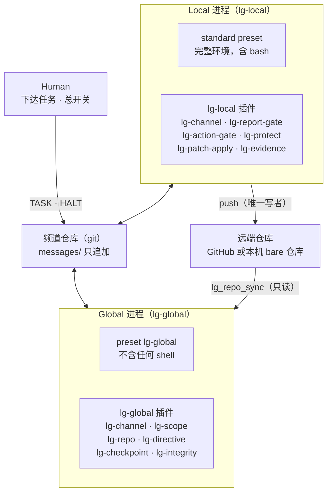

# Local–Global 实现文档：基于 DeepSeek Harness

Oct 21, 2026 · @ji qi

## 概述

实现方式：用两个 DeepSeek Harness（dsh）进程分别承载 Global 和 Local，框架本身全部写成 dsh 插件，打包成 `lg-common`、`lg-local`、`lg-global` 三个 bundle。频道默认是一个 git 仓库（契约见 `docs/channel-git.md`），不需要单独的服务。不改 dsh 的任何代码。

**为什么基于 dsh**

- dsh 一切皆插件：模型适配、工具注册表、会话日志，甚至 agent loop 本身都是插件，都能从配置替换。
- 框架需要的扩展点它都有：工具注册与按作用域过滤、工具调用前不可推翻的拦截、向会话投递消息并唤醒、回合结束前拦截、按会话组合插件的 agent preset。
- 隔离可以落在插件层：Global 的会话里根本不装 shell 工具，文件和网络访问都经过守卫。整个方案不需要 root、容器或单独的系统用户。

**v0.1 范围**

本地模式、git 频道、两侧插件、角色说明、启动步骤。云端模式和度量统计放到后续版本。

**前提**

dsh 目前是 developer preview，官方明确说明会有不兼容变更。本文基于 dsh 仓库 2026 年 10 月的 master 文档；插件要在 `package.json` 里用 `engines.dsh` 写明支持的版本范围，dsh 会拒绝加载版本不符的 bundle。

## DeepSeek Harness 架构要点

一个运行中的 dsh 是一棵 Cordis 插件树：插件通过 `ctx` 注册服务、事件监听和可撤销的副作用，插件卸载时这些注册自动回收。

**组合方式**

- **插件**：导出 `apply(ctx, config)` 的 TypeScript 模块。`inject` 声明依赖的服务，配置用 Schemastery 校验。
- **bundle**：一个 npm 包，带一份 `cordis.patch.yml`，往组合里插入或覆盖插件行。
- **profile**：`$DSH_HOME/profiles/<名字>` 下的一个可运行组合，按顺序叠加 bundle。用 `dsh plugin --profile <名字> add <包>` 安装，用 `dsh --profile <名字> --dump-config` 查看最终组合。
- **叠加顺序**：bundle 层，然后 profile 的 `cordis.patch.yml`，然后 `$DSH_HOME/cordis.patch.yml`，最后命令行 `--patch`。后面的层按行 id 覆盖前面的，而且是整行 `config` 替换，不做深合并。
- **agent preset**：用 YAML 声明一个会话里装哪些插件。Web 版的模型工具（bash、read、write、web\_fetch 等）都挂在 preset 里，进程级的同名行是关闭的。

**本框架用到的扩展点**

| 扩展点 | 作用 | 框架里的用途 |
| --- | --- | --- |
| `ctx.tools.register` + `defineTool` | 注册模型可调用的工具 | 频道、补丁、证据、仓库等 `lg_*` 工具 |
| `ctx.tools.restrict` | 按作用域只保留或移除部分工具 | Global 只保留白名单工具 |
| `ctx.tools.guard` | 单调拒绝：任何一个守卫拒绝，其他监听都无法放行 | 路径范围、受保护路径、C 类动作拦截 |
| `tools/pre-execute` 瀑布 | 异步的允许、拒绝或询问 | 网络目标检查（要先解析域名） |
| `agent.followup` / `steer` / `inject` / `cancel` | 向会话投递消息、唤醒或中止 | 频道消息送达、HALT |
| `agent/turn-stopping` | 回合结束前拦截；用 `steer` 让回合再跑一步 | 强制 REPORT、强制先答问题 |
| `ctx.commands.register` | 不经过模型的人工命令 | `/lg-bind`、`/lg-halt`、`/lg-status` |
| `ctx.schedule` | 定时向会话投递消息 | 全局检查点 |
| `ctx.subprocess` | 以固定 argv 启动子进程 | 插件代执行 git |
| `agent-instructions` 插件 | 从工作目录加载指令文件 | 加载角色说明 |

**两条要注意的边界**

- dsh 自带的进程 sandbox（Linux 用 bwrap 或 Landlock，macOS 用 Seatbelt，Windows 用受限令牌）只管文件写入；网络和进程可见性不在它的范围内，读文件也不拦。所以它挡不住 Global 读本地文件，这一层要由插件来做。
- 文件系统事件只拦截写入和编辑（`fs/write-intent`、`fs/edit-intent`），没有读取拦截。读路径的检查要放在工具守卫里。

## 总体方案

Global 和 Local 各是一个独立的 dsh 进程，用不同的 `DSH_HOME` 和 profile；它们之间没有任何直接通道，只通过频道仓库对话、通过远端仓库共享事实。



高亮的 preset lg-global 是隔离的关键：Global 的会话里没有 shell，它对仓库的所有操作都由 lg-repo 代做。Local 保留 dsh 自带的 standard preset，框架只在它外面加守卫和工具。

为什么用两个进程，而不是一个进程里两个 preset：

- 凭据、会话日志和配置各自独立，Local 的配置改动不会影响 Global。
- 进程级的守卫可以直接覆盖该进程的所有会话和子 agent，不必区分当前是哪个角色。
- 以后把 Global 搬到云端时，只是换一台机器跑同一个 profile。

## 插件清单

框架共 12 个插件、1 个库和 1 个 preset。除 preset 外都挂在进程级：Global 进程里所有会话都是 Global 侧，Local 进程里的守卫对主会话和它派生的子 agent 一样生效。

| 插件 | 所在包 | 职责 |
| --- | --- | --- |
| lg-protocol | 库，不是插件 | 消息信封、补丁信封、证据清单的类型与校验 |
| lg-channel | lg-common | 连接频道、维护游标、把消息投递给绑定的会话；提供 `lg_post`、`lg_record_relayed`、`lg_read`、`lg_open_questions` |
| lg-commands | lg-common | `/lg-bind`、`/lg-halt`、`/lg-status` |
| lg-report-gate | lg-local | 回合结束前检查是否欠 REPORT |
| lg-action-gate | lg-local | C 类动作守卫：没有对应 DECISION 就拒绝 |
| lg-protect | lg-local | 受保护路径守卫：Local 不碰 Global 的目录 |
| lg-patch-apply | lg-local | `lg_apply_patch`：校验并应用 Global 的补丁 |
| lg-evidence | lg-local | `lg_evidence_add`、`lg_evidence_check`：写证据清单、标记过期 |
| lg-scope | lg-global | 文件路径限定在工作区；拒绝执行类工具；网络不许指向本机和局域网 |
| lg-repo | lg-global | `lg_repo_sync`、`lg_repo_log`、`lg_repo_diff`、`lg_repo_show` |
| lg-directive | lg-global | `lg_directive`、`lg_draft_reset`、`lg_patch_send`、`lg_stop` |
| lg-checkpoint | lg-global | 定时全局检查点；回合结束前检查未答问题 |
| lg-integrity | lg-global | 启动自检、配置哈希检查 |
| preset `lg-global` | lg-global | Global 会话的工具组合：不含任何 shell |

Local 侧不另做 preset，继续用 dsh 自带的 standard preset，保留完整的执行能力。

## 频道插件

lg-channel 把频道接进 dsh：拉取新消息，按规则投递给绑定的会话，并提供发消息的工具。频道默认是一个 git 仓库，完整契约见 `docs/channel-git.md`。两侧共用同一个插件，只是 `role` 不同。

```yaml
- insert:
    - id: lg-channel
      name: '@local-global/dsh-lg-common/channel'
      config:
        repo: 'https://github.com/<owner>/<频道仓库>.git'   # 或 file:///path/to/channel.git
        branch: main
        role: local              # Global 进程里写 global
        pollSeconds: 60
        relay: false             # Global 不能直接写频道仓库时，Local 侧设为 true
```

git 认证沿用本机已有的 git 凭据，插件不保存任何令牌。

**绑定会话**

用户在要承担该角色的会话里执行 `/lg-bind`，插件把这个会话 id 存进 dsh 的存储，之后频道消息只投递给它。子 agent 不会被绑定，也不直接收频道消息。绑定时插件用 `agent.inject` 把角色说明注入这个会话。

**拉取与游标**

插件每 `pollSeconds` 秒 fetch 一次频道仓库，按序号处理新消息。游标是已投递的最大序号，存在 dsh 的存储里，只在消息成功投递后前移，所以进程重启后消息不丢也不重。校验不通过的消息不投递原文，改为投递一条说明原因的提示。

**投递规则**

| 收到的消息 | 会话正在运行 | 会话空闲 |
| --- | --- | --- |
| 对方的任何消息，以及 Human 的 TASK | `steer`：在下一步边界读到 | `followup`：开一个新回合 |
| HALT | `cancel`，并停止后续投递 | 同左 |
| 自己发出的消息 | 不投递 | 不投递 |

投递内容是一条带标签的用户消息，例如 `[LG #349 DIRECTIVE v7 from global]`，后面附完整字段。dsh 的原则是“模型可见的输入都要进日志”，所以每次投递都留在会话日志里，可以回溯。

**发消息工具**

- `lg_post`：参数为 `type`、`refs`、`fields`、`body`、`attachments`。插件负责取序号、写文件、提交和 push，push 冲突时重新取号重试。
- `lg_record_relayed`：仅中转模式可用。参数是 Human 粘贴过来的 Global 或 Human 消息全文，插件原样存档。
- `lg_read`：按序号范围读历史消息。
- `lg_open_questions`：列出未关闭的 QUESTION 和 OBJECTION。

`lg_post` 发送前先在本地校验，不通过就返回错误让模型补全，而不是发出残缺消息：

1. 角色能否发这种类型。Local 不能发 DIRECTIVE、PATCH、DECISION、STOP；Global 不能发 REPORT、QUESTION、OBJECTION。
2. 必填字段是否齐全，规则见设计文档的“频道协议”。
3. REPORT 引用的证据路径是否都有清单，且没有过期。

git 后端里，发送者身份靠首行和文件名声明，仓库本身不能防伪。防伪由 Global 负责：它每次读取频道时，把所有 from global 的消息与自己保存的发送副本逐字节比对，不一致就发 ISOLATION_REPORT。

## Local 侧插件

Local 侧插件的作用是把“必须汇报、先批后做、不碰 Global”这三条从提示词变成代码：模型没遵守时，由插件挡下或提醒。

**lg-report-gate：不让 Local 悄悄结束回合**

监听 `agent/turn-stopping`。回合将要结束时检查：

1. 当前 HEAD 是否已在某条 REPORT 里报过
2. 最新 DIRECTIVE 的版本是否已被 REPORT 确认
3. 本回合新增的证据文件是否都写了清单

任何一项不满足，就 `steer` 一条提示，要求先补 REPORT。按 dsh 的规则，回合结束监听里一旦 steer，回合就会再跑一步。

**lg-action-gate：C 类动作先批后做**

用 `ctx.tools.guard` 注册。守卫是单调的：它一旦拒绝，其他任何监听都无法放行。规则写在配置里：

```yaml
- insert:
    - id: lg-action-gate
      name: '@local-global/dsh-lg-local/action-gate'
      config:
        rules:
          - id: force-push
            tool: bash
            match: 'git\s+push\s+.*(--force|-f\b)'
          - id: recursive-delete
            tool: bash
            match: '\brm\s+-[a-zA-Z]*(rf|fr)'
          - id: publish
            tool: bash
            match: '\b(npm|pnpm)\s+publish\b'
```

批准流程：

1. 命令命中规则，守卫拒绝，拒绝理由里带上动作指纹（规则 id 加命令文本 sha256 的前 12 位），并提示先请求批准
2. Local 发 QUESTION，`fields.action` 写这个指纹
3. Global 发 DECISION，`fields.approve_action` 写同一个指纹
4. 守卫看到匹配的 DECISION 后放行一次，用过即失效

守卫必须是同步函数，所以它读的是 lg-channel 在内存里维护的已批准指纹表，而不是现场读取频道仓库。

**lg-protect：Local 不碰 Global 的目录**

守卫检查 Local 的 `read`、`write`、`edit`、`glob`、`grep` 的路径参数，以及 `bash` 的命令文本。只要指向配置里的受保护路径（Global 的 `DSH_HOME` 和工作区），就拒绝。

这一层是规则级的：bash 可以用间接写法绕过文本匹配，所以它防的是误操作和模型自发越界，不防刻意绕过。“隔离策略”一节说明为什么这样也够用。

**lg-patch-apply：应用 Global 的补丁**

`lg_apply_patch` 的参数是 PATCH 消息的编号，工具确定性地完成以下步骤：

1. 从频道取回所有分片并拼合，校验 bytes 与 sha256，不符则返回 REJECTED
2. 若 `git apply --check --reverse` 能通过，说明改动已经存在，返回 DUPLICATE
3. 检查 base 是否为 HEAD 的祖先，然后 `git am`；冲突时回滚并返回 CONFLICT
4. 成功则返回 APPLIED 和新 commit

git 由插件通过 `ctx.subprocess` 以固定参数调用，不经过 shell。工具不替模型发 REPORT，结果交给模型去写。

**lg-evidence：证据工具**

- `lg_evidence_add`：参数为 claim、environment（`real` 或 `simulated`）、target\_environment、command、raw 文件列表、negative\_tests、result。工具自动填入当前 commit 和产物 digest（由配置的命令算出），确认 raw 文件存在，写出 `evidence/<主题>/manifest.json`。
- `lg_evidence_check`：扫描所有清单，把 digest 与当前不符的标为 stale。

## Global 侧插件

Global 侧的原则是“不给，而不是禁止”：Global 的会话里根本没有 shell 工具，它能做的事只剩一组受守卫的工具，git 也由插件代为执行。

**preset lg-global：没有 shell 的工具组合**

lg-global bundle 的 `cordis.patch.yml` 声明这个 preset，把它设为默认，并关掉 Web 模板自带的其他 preset，避免用户在界面里切到带 bash 的 standard：

```yaml
- insert:
    - id: preset-lg-global
      name: '@deepseek-ai/dsh-agent-preset'
      config:
        id: lg-global
        name: Global
        plugins:
          - id: persona
            name: '@deepseek-ai/dsh-persona'
            config:
              prefix: You are Global, the judge in a Local-Global pair, powered by {{model}}.
          - id: agent-instructions
            name: '@deepseek-ai/dsh-agent-instructions'
            config:
              maxBytes: 65536
              instructionFileCandidates: ['LG-ROLE.md']
          - id: tool-fs
            name: '@deepseek-ai/dsh-tool-fs'
            config: { read: true, readImage: true, write: true, edit: true }
          - id: tool-fs-search
            name: '@deepseek-ai/dsh-tool-fs-search'
            config: { sampleOverCapGlobResults: false }
          - id: tool-web
            name: '@deepseek-ai/dsh-tool-web'
            config: { fetch: true, searchTimeoutMs: 60000 }

- id: agent-preset-registry
  name: '@deepseek-ai/dsh-agent-preset-registry'
  config:
    default: lg-global

- id: preset-standard
  disabled: true
- id: preset-cordis
  disabled: true
- id: preset-ptc
  disabled: true
- id: preset-minimal
  disabled: true
```

角色说明放在 Global 工作区根目录的 `LG-ROLE.md`，由 `agent-instructions` 每个会话加载。写权限只用于 Global 自己的草稿目录，由 lg-scope 限定。

**关掉别的 preset 不等于切不过去。** bundle 的 patch 层在用户 patch 层之下，用户在 `cordis.patch.yml` 里重写 `agent-preset-registry.default` 就能把会话切回带 bash 的 standard。所以 preset 只负责“默认安全”，真正的保证由 lg-integrity 在启动时给出：它读取组合后的 preset 注册表，断言 `default` 是 `lg-global`、且没有其他 preset 处于启用状态，任何一条不成立就发 ISOLATION\_REPORT 并拒绝工作。

**lg-global 只能装进专用 profile。** 它会关掉所在 profile 里的 standard 等 preset，装进用户平时用的 profile 会让那个 profile 失去 bash。所以 lg-scope 启动时检查当前 profile 名，必须以 `lg-global` 开头（前缀可配置），否则拒绝启动并说明原因。profile 名从 dsh 的 `profileContext` 服务读取，具体字段以所用版本为准。

**lg-scope：文件与网络的范围**

- **文件**：守卫检查 `read`、`read_image`、`write`、`edit`、`glob`、`grep` 的路径参数（`file_path` 或 `path`）。先按会话目录解析成绝对路径，再取真实路径，必须落在 Global 工作区内，否则拒绝。取真实路径是为了挡住 `..` 和符号链接逃逸。
- **工具名**：`bash`、`pwsh`、`terminal_*`、`job_*`、`subagent*` 等执行类和派生类工具一律拒绝。preset 里本来就没有它们，这是第二道防线。
- **网络**：在 `tools/pre-execute` 里检查 `web_fetch` 的目标，默认是 **allowlist**，名单可配置。放 pre-execute 而不是守卫里，是因为解析域名是异步的，守卫必须同步。
  - 只允许 `http` 和 `https`；`file://`、`ftp://`、`data:` 等其他协议一律拒绝。
  - 比对的是**解析后的地址**与声明的域名两者：域名必须在名单里，解析结果也不能落在本机、局域网或链路本地地址（127.0.0.0/8、::1、10.0.0.0/8、172.16.0.0/12、192.168.0.0/16、169.254.0.0/16 等）。
  - 先解析再判断存在 DNS rebinding 的时间差：名单模式要求解析结果命中名单里预先登记的地址集合，或把解析结果固定之后才发请求。
  - 默认名单（可覆盖）：`github.com`、`api.github.com`、`raw.githubusercontent.com`、`codeload.github.com`、`objects.githubusercontent.com`、`gist.github.com`、`gist.githubusercontent.com`。这张表只覆盖“读 GitHub 上的公开仓库内容”，模型 API 走适配器自己的网络，不经过 `web_fetch`。

**lg-repo：Global 读仓库的唯一途径**

| 工具 | 作用 |
| --- | --- |
| `lg_repo_sync` | 从配置的远端 fetch，把只读镜像硬重置到远端分支，同时撤销对镜像的任何改动 |
| `lg_repo_log` | 列出提交，默认从上次看到的 commit 开始 |
| `lg_repo_diff` | 两个 commit 之间的 diff，可按路径过滤 |
| `lg_repo_show` | 读某个 commit 下的某个文件 |

远端可以是 GitHub（只读凭据），也可以是本机的 bare 仓库（`file://` 路径）。插件里没有任何 push 代码路径，但仍要把“推不上去”做成事实而不是约定：

- 建立镜像后立即把 `remote.origin.pushurl` 设成无效值（例如 `file:///dev/null`），让同一个 origin 想推也推不了。
- 凭据只给只读权限：deploy key 只读，或 fine-grained token 只开 Contents: Read。
- 启动探针实测：用现有凭据对镜像执行一次 `git push --dry-run`，**必须失败**；成功就说明环境里混进了写凭据，发 ISOLATION\_REPORT 并拒绝工作。

**lg-directive：Global 的写出口**

- `lg_directive`：发 DIRECTIVE。插件保存当前版本并自动递增版本号，要求目标、优先级、验收标准全部写全，不接受增量指令。
- `lg_draft_reset`：把草稿目录 `drafts/` 重置到指定 base。草稿目录与只读镜像分开，Global 在这里改代码。
- `lg_patch_send`：在草稿目录提交改动，执行 `git format-patch`，打包成补丁信封（base、bytes、sha256、base64 分片），先发 CLAIM 再发 PATCH。
- `lg_stop`：发 STOP。工具**先执行一次 `lg_repo_sync`**，再以配置的 `final_commit` 与镜像 HEAD 比对，两者不一致直接拒绝——否则会对着一个落后的镜像验收。比对通过后逐条打开验收标准对应的清单，检查 environment 为 `real` 且 digest 是当前版本；任何一条不满足就拒绝发送。
- `environment` 是自报字段，Global 无法独立验证“这条证据真的来自目标环境”。这一点留到 M3 的 lg-evidence 解决（要求 real 证据附带只有目标环境能产生的探针输出），M2 只把它当声明记录。

**lg-checkpoint：保护全局视角**

- 用 `ctx.schedule` 设一个固定间隔（默认 30 分钟，可配置），到点向 Global 会话投递“全局检查点”消息，要求回答三个问题并发到频道。
- 监听 `agent/turn-stopping`：若还有未关闭的 QUESTION 或 OBJECTION，就 `steer` 一条提示，要求先答再结束。

**lg-integrity：Global 的自检**

启动时和每次 `lg_repo_sync` 时执行：

1. **枚举工具白名单**：列出 Global 会话当前可见的全部工具，与配置的白名单（`read`、`read_image`、`write`、`edit`、`glob`、`grep`、`web_fetch`、`web_search`、`lg_*`、`present`）逐一比对。出现白名单以外的名字，就发 ISOLATION\_REPORT 并暂停工作。这是规则层内堵住“用户 patch 加回 bash”的主要手段——不看配置怎么写，只看会话实际能调到什么。
2. **断言 preset**：`agent-preset-registry.default` 必须是 `lg-global`，且没有其他 preset 处于启用状态。
3. **组合哈希**：对 `--dump-config` 的**解析结果**（不是 profile 文件）算哈希，与上次比对。文件没变而 bundle 版本变了，也要能发现。
4. **负向自测**：用 lg-scope 的规则尝试读 Local 的工作目录、访问本机地址、对镜像 push，三者都必须失败。
5. **副本比对**：把频道里所有 from global 的消息与 Global 自己保存的发送副本逐字节比对，不一致就发 ISOLATION\_REPORT。

## 隔离策略

默认采用规则层隔离：不需要 root、容器或单独的系统用户，任何能跑 dsh 的用户都能用。系统级隔离保留为可选增强。

这是 Human 明确拍板的默认：不为了隔离把用户挡在门外。因此“Global 与 Local 使用不同的 `DSH_HOME`”保留为**部署前提**（它不需要任何额外权限），而“独立系统用户或容器”只作为可选增强列出。

**三层规则**

| 层 | Global 侧 | Local 侧 |
| --- | --- | --- |
| 能力组合 | preset 里不装 shell、终端、后台任务和子 agent 工具 | 照常拥有完整环境 |
| 插件守卫 | 文件路径限定在工作区；网络不许指向本机和局域网；执行类工具名一律拒绝 | 受保护路径守卫；C 类动作守卫 |
| 角色指令 | `LG-ROLE.md` 写明边界 | `/lg-bind` 注入的角色说明写明边界 |

**为什么规则要写进守卫，而不只写进提示词**

现在的模型指令遵循能力确实很强，规则层足以覆盖绝大多数情况。但 OnCue 里 A2 也出现过“只 stamp 一次”却 stamp 了两次、先改 catalog 再请示。写进守卫的规则同样不需要系统权限，区别在于：执行与否不再取决于模型当时有没有遵守。

**两个方向的强度不对称，这是可以接受的**

- 正向隔离（Global 看不到 Local）在规则层可以做到足够强，但**不能只靠“preset 里没有 shell”**：dsh 的进程 sandbox 不拦读取，用户 patch 又能改回带 bash 的 preset。强度来自三件事叠加——能力组合默认不含 shell、守卫拦住每一次文件与网络访问、lg-integrity 按会话实际可见的工具做白名单枚举。
- 反向隔离（Local 改不了 Global）在规则层较弱。Local 有 bash，文本匹配挡不住刻意的间接写法。
- 框架的核心性质只依赖正向隔离：Global 的判断不能建立在 Local 的转述上。Local 即使读到 Global 的会话记录，也只是看到了 Global 的想法，并不破坏这一点。
- 反向的真正风险是 Local 篡改 Global 读到的东西。lg-integrity 负责发现：Global 每次同步都把镜像硬重置到远端，配置文件被改会被哈希比对发现。

**可选增强**

需要更强隔离的用户，可以把 Global 进程放进容器或虚拟机，或用单独的系统用户运行，做法见设计文档的“隔离设计”一节。这不是默认要求。

## 配置与启动

两个 dsh 进程用不同的 `DSH_HOME`，所以凭据、会话和 profile 互不相通；同机运行时端口分别是 3080 和 3081。

**目录约定**

```text
~/.lg-global/home/         Global 的 DSH_HOME（凭据、会话、profile）
~/.lg-global/workspace/    Global 的工作区，LG-ROLE.md 放在这里
    repo/                  只读镜像，每次同步硬重置
    drafts/                Global 写补丁用的草稿克隆
~/projects/<项目>/         Local 的工作目录
```

**1. 准备频道仓库**

在 GitHub 新建一个公开仓库作为频道，或者在本机建一个 bare 仓库：

```sh
git init --bare ~/.lg/channel.git
```

**2. 安装并启动 Local**

```sh
dsh --profile lg-local --from-default-profile web     # 首次：从 Web 模板创建 profile
dsh plugin --profile lg-local add @local-global/dsh-lg-common @local-global/dsh-lg-local
cd ~/projects/<项目> && dsh --profile lg-local
```

在打开的 Web 界面里新建会话，执行 `/lg-bind`。

**3. 安装并启动 Global**

```sh
export DSH_HOME=~/.lg-global/home
dsh --profile lg-global --from-default-profile web
dsh plugin --profile lg-global add @local-global/dsh-lg-common @local-global/dsh-lg-global
cd ~/.lg-global/workspace && dsh --profile lg-global --port 3081
```

在 Global 的界面里配置模型（建议与 Local 不同家、并支持图像输入），新建会话并执行 `/lg-bind`。

**4. 下达任务与停止**

Human 把任务交给 Local：中转模式下由 Local 用 `lg_record_relayed` 存档，否则直接把 `messages/<序号>-human-TASK.md` 提交到频道仓库。任一侧界面里执行 `/lg-halt` 即写入一条 HALT，两个会话都会停止。

**lg-local 的关键配置**

```yaml
- insert:
    - id: lg-protect
      name: '@local-global/dsh-lg-local/protect'
      config:
        protectedPaths: ['~/.lg-global']
    - id: lg-evidence
      name: '@local-global/dsh-lg-local/evidence'
      config:
        digestCommand: ['git', 'rev-parse', 'HEAD']   # 有产物 digest 时换成对应命令
```

**lg-global 的关键配置**

```yaml
- insert:
    - id: lg-scope
      name: '@local-global/dsh-lg-global/scope'
      config:
        workspace: '~/.lg-global/workspace'
        network: allowlist           # 默认值，只有 allowlist 一种模式
        allowDomains:                # 默认表，可覆盖；见“lg-scope”一节
          - github.com
          - api.github.com
          - raw.githubusercontent.com
          - codeload.github.com
          - objects.githubusercontent.com
          - gist.github.com
          - gist.githubusercontent.com
    - id: lg-repo
      name: '@local-global/dsh-lg-global/repo'
      config:
        remote: 'https://github.com/<owner>/<repo>.git'   # 或 file:///path/to/remote.git
        branch: main
        tokenEnv: LG_REPO_READ_TOKEN      # 只读凭据；pushurl 由插件置空
        denyPush: true                    # 启动探针会实测 push 必须失败
    - id: lg-checkpoint
      name: '@local-global/dsh-lg-global/checkpoint'
      config:
        everyMinutes: 30
```

`dsh --profile <名字> --dump-config` 可以确认这些行确实进入了组合。

## 测试与验收

每个插件都要有正测和负测；负测证明守卫不是空转，这正是框架要求 Local 做的事，插件自己也要做到。

| 插件 | 正测 | 负测 |
| --- | --- | --- |
| lg-channel | 消息按规则投递到绑定会话；重启后游标不丢不重 | 缺必填字段的 `lg_post` 被拒；Local 发 DIRECTIVE 被拒；文件名与首行的发送者或类型不一致被拒；push 冲突后重新取号成功 |
| lg-action-gate | 有匹配 DECISION 时命令执行一次 | 无 DECISION 时 force push 被拒；同一批准第二次使用被拒 |
| lg-report-gate | 已发 REPORT 时回合正常结束 | 有新 commit 未报时，回合被 steer 继续 |
| lg-patch-apply | 正确的补丁返回 APPLIED | 哈希不符返回 REJECTED；已存在返回 DUPLICATE；冲突返回 CONFLICT 且已回滚 |
| lg-evidence | 清单写出并绑定当前 commit | digest 变化后清单被标 stale；REPORT 引用它被拒 |
| lg-protect | Local 正常读写项目文件 | `read` 或 `bash` 指向 Global 目录被拒 |
| lg-scope | 读工作区内的文件成功 | 读 Local 工作目录、`../` 逃逸、符号链接逃逸都被拒；`web_fetch` 到 127.0.0.1 或解析到局域网的域名被拒 |
| lg-repo | 同步后镜像等于远端 HEAD | 手工改动镜像后再同步，改动被撤销 |
| lg-directive | 所有标准都有 real 证据时 `lg_stop` 发出 | 只有 simulated 证据或证据过期时 `lg_stop` 被拒 |
| preset lg-global | 会话工具列表里没有任何 shell | 界面里无法切换到其他 preset |

**端到端回放**

用 OnCue 讨论记录里的三个典型问题做回放用例，验证 Global 能在没有 Local 提示的情况下发现它们：

1. 证据版本错配（#357）：证据绑定旧 digest，应被标 stale
2. 模拟环境通过、真实环境失败（#365）：只有 simulated 证据，`lg_stop` 应被拒
3. 计数门禁假绿（#332）：缺少负测的“通过”，应被 Global 退回

## 里程碑与待确认问题

按依赖顺序分四步，每步结束都有可演示的结果。

1. **M1 通信**：lg-protocol、lg-channel（git 后端）、lg-commands。两边能互发消息，`/lg-halt` 能让两边停下。
2. **M2 Global 隔离**：preset lg-global、lg-scope、lg-repo、lg-integrity。隔离负测全部通过。
3. **M3 Local 约束**：lg-evidence、lg-patch-apply、lg-report-gate、lg-action-gate、lg-protect。
4. **M4 判断闭环**：lg-directive、lg-checkpoint。用 OnCue 的三个回放用例做端到端验收。

**待确认**

- dsh 仍是 developer preview：插件以哪个 dsh 版本为基线，`engines.dsh` 的范围怎么定？
- Global 用哪个模型？要检查截图证据，它必须支持图像输入，因为 `read_image` 只在路由的模型声明支持图像时才执行。
- 会话绑定用手动的 `/lg-bind`，还是收到 TASK 时由插件自动建会话？
- 文中的插件行 id、配置字段和 `UserMessage` 的构造方式，需要对照所用 dsh 版本的 `--dump-config` 输出和子系统文档逐项核实。

**Sources**

- [DeepSeek Harness 仓库与 README](https://github.com/deepseek-ai/deepseek-harness)
- [Architecture](https://github.com/deepseek-ai/deepseek-harness/blob/master/docs/architecture.md)
- [Tool Execution Pipeline](https://github.com/deepseek-ai/deepseek-harness/blob/master/docs/tool-execution-pipeline.md)
- [Tools 子系统](https://github.com/deepseek-ai/deepseek-harness/blob/master/docs/subsystems/tools.md)
- [Core：Agent 句柄与事件](https://github.com/deepseek-ai/deepseek-harness/blob/master/docs/subsystems/core.md)
- [Process Sandbox](https://github.com/deepseek-ai/deepseek-harness/blob/master/docs/subsystems/sandbox.md)
- [Filesystem](https://github.com/deepseek-ai/deepseek-harness/blob/master/docs/subsystems/filesystem.md)
- [Your first plugin](https://github.com/deepseek-ai/deepseek-harness/blob/master/docs/user/develop/basic/index.md)
- [Package and install a plugin](https://github.com/deepseek-ai/deepseek-harness/blob/master/docs/user/develop/basic/publish.md)
- [dsh-agent-preset](https://github.com/deepseek-ai/deepseek-harness/blob/master/packages/preset/agent-preset/README.md)
- [web-app bundle 的 standard preset](https://github.com/deepseek-ai/deepseek-harness/blob/master/packages/bundle/web-app/presets/standard.patch.yml)
- [Tool catalog](https://github.com/deepseek-ai/deepseek-harness/blob/master/docs/tool-catalog.md)
- [Config catalog](https://github.com/deepseek-ai/deepseek-harness/blob/master/docs/config-catalog.md)
- [Safety](https://github.com/deepseek-ai/deepseek-harness/blob/master/SAFETY.md)
