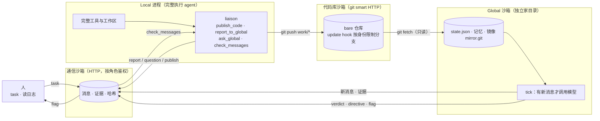

# Local–Global（v0.2）：三个沙箱

> **状态：未采纳的提案。** 项目的开发依据仍是 [`docs/spec.md`](../docs/spec.md)（SPEC v2），主线实现在 `packages/`。本提案取消了 SPEC 的两条不变量——Global 唯一的 STOP 权（不变量 5）和 Human 的 HALT（不变量 6），也不再以 dsh 插件交付；按 SPEC“已定决策”一节，这类改动只能由 Human 决定，在决定之前本目录只作参考，不在 CI 里跑，也不接受针对它的修复。已知问题见仓库根目录 README 的“redesign/”一节。

## 一句话

Local 是一个完整的执行 agent，有自己的上下文和工具，**不依赖 Global 也能跑完任务**。Global 是独立的审阅者，有自己的上下文、记忆和工具，只通过消息和代码库了解 Local，给出建议，需要人决定时升级给人。

三个沙箱分别替代三样外部依赖，让框架在没有公共平台、没有 GitHub、没有网页版 Global 的情况下也能跑：

| 沙箱 | 替代的依赖 | 承载什么 | 谁能做什么 |
| --- | --- | --- | --- |
| **通信沙箱** | 公共通信平台 | 消息、证据（带哈希） | 每个角色只能发它被允许的种类；只能读发给自己的消息；Global 只能读发给它的证据 |
| **代码库沙箱** | GitHub | 交付用的 git 仓库（smart HTTP） | Local 只能推 `work/*`；Global 只读；历史只能前进，不能删分支 |
| **Global 沙箱** | 网页版 Global | Global 的家目录：状态、记忆、代码库只读镜像 | Global 的工具只在家目录内；没有 shell；拿不到 Local 的凭据和工作区路径 |

## 三个上下文

| 上下文 | 内容 | 与其他上下文的关系 |
| --- | --- | --- |
| **Local** | 执行者完整的会话、完整的工作区 | 框架只加四个工具，并把 `check_messages` 的结果交给它。不注入 Global 的记忆或状态 |
| **Global** | 角色提示、记忆笔记、人给的任务、代码库当前状态、自己的历史 | 看不到 Local 的会话和工作区。只通过通信沙箱（消息、证据）和代码库（commit）了解 Local |
| **代码库** | 分支和 commit，交付物 | 给人看，也给 Global 核对。不是对话上下文，Local 不会从这里读到 Global 的内容 |

## 架构



Local 的工作路径上没有任何等待 Global 的节点。Global 读取的只有两个沙箱里的东西。

## 工具

**Local（执行者）**

| 工具 | 作用 |
| --- | --- |
| `publish_code` | 把已提交的 HEAD 推到代码库的 `work/*` 分支。工作区必须干净 |
| `report_to_global` | 汇报进展，附证据文件。证据在本地读取，连同哈希一起上传 |
| `ask_global` | 提问，不阻塞 |
| `check_messages` | 非阻塞地取回 Global 或人的消息，只返回一次 |

**Global（审阅者）**

| 工具 | 作用 |
| --- | --- |
| `read_file` | 读代码库中某个分支或 commit 下的文件（只读镜像） |
| `repo_log` | 查看某个分支的最近提交 |
| `read_artifact` | 读取某条消息声明过的证据，并校验它的哈希 |
| `send_directive` | 给执行者的指令，可附验收标准 |
| `send_verdict` | 对某条汇报给出 accepted / needs_work / unverified，附 findings |
| `flag_human` | 升级给人 |
| `save_memory` | 替换自己的记忆笔记 |

Global 没有 shell，没有工具接受绝对路径，也没有写代码库的能力。

**人**：`lg human say`（发 task 或 note）、`lg human log`（读全部消息，只有人的 token 能用）。

## 一次完整的交互

1. 人给 Global 和 Local 各发一条 task。
2. Local 工作、提交、`publish_code` 推到 `work/main`，然后 `report_to_global` 附上证据。Global 此时可能没有运行，没关系，消息留在通信沙箱里。
3. Local 可以继续工作，比如再提交一次但不发布。它汇报时，`published_branch` 为空。
4. Global 运行 `tick`：拉取代码库镜像，核对每个报告的 commit 是否在代码库里、是否在声明的分支上；用 `read_file` 和 `repo_log` 读代码；用 `read_artifact` 读证据；然后给出 verdict 和 directive，并更新记忆。
5. Local 调用 `check_messages` 取回建议，自己决定怎么做。如果不同意，在下一次汇报里说明理由。
6. 需要人决定的事，Global 用 `flag_human` 升级。

## 运行

```sh
cd redesign
npm test                      # 49 个测试：三个沙箱、两个角色、端到端
npm run demo                  # 完整演示，包括离线、未发布的 commit、越权尝试

# 一台机器上部署三个沙箱
node bin/lg.js init  --root ./lab                 # 生成 token、代码库、工作区、各角色的配置
node bin/lg.js serve --root ./lab                 # 启动通信沙箱和代码库沙箱
node bin/lg.js human say --config ./lab/roles/human.json --to local "先处理空输入"
LG_API_KEY=... node bin/lg.js global tick --config ./lab/roles/global.json
node bin/lg.js human log --config ./lab/roles/human.json
```

`lg init` 为每个角色生成只含自己 token 的配置文件（`roles/local.json`、`roles/global.json`、`roles/human.json`）。`server.json` 含所有 token，只给运维用，不要放进任何角色的进程。

## 谁强制了什么

| 规则 | 由谁强制 |
| --- | --- |
| 发送方身份 | 通信沙箱：从 token 推导角色，忽略消息体里的 `from` |
| 消息种类与收发方 | 通信沙箱：`protocol.js` 规则，违反返回 400 |
| 只能读发给自己的消息 | 通信沙箱：收件箱按角色过滤 |
| Global 只能读发给它的证据 | 通信沙箱：角色与 `to` 检查，返回 403 |
| 证据内容未被篡改 | 通信沙箱存储时计算哈希，读取时校验（409）；Global 下载后再校验一次 |
| Local 只能推 `work/*` | 代码库沙箱：`update` hook，按 `REMOTE_USER` 判断 |
| Global 不能推代码 | 代码库沙箱：HTTP 层按角色返回 403，hook 也会拒绝 |
| 历史只能前进 | 代码库沙箱：`receive.denyNonFastForwards`、`receive.denyDeletes` |
| Global 只能访问自己的家目录 | Global 工具：路径经 `safeRelative` 校验，ref 限制在镜像内 |
| Global 不持有 Local 的凭据 | 部署：`roles/global.json` 里没有 Local 的 token；测试验证了 Local 配置里不含 Global token |

## 失败场景

| 情况 | 行为 |
| --- | --- |
| Global 没运行 | 消息留在通信沙箱，下次 tick 时一并处理 |
| 通信沙箱不可达 | 汇报存在本地 outbox，下次调用时补投。`check_messages` 返回错误但不阻塞 |
| 证据不存在或越界 | 汇报被拒绝，返回错误，不会发出残缺的汇报 |
| 报告的 commit 没有发布 | Global 看到 `NOT PRESENT` 或 `published_branch` 为空，verdict 应为 needs_work 或 unverified |
| 证据在通信沙箱里被改动 | 读取时返回 409，Global 也拒绝使用，应当 `flag_human` |
| 模型报错 | 批次保持未读，状态回滚，下次 tick 重试。已经发出的消息用 `client_id` 去重，不会重复 |
| Local 推 `main` 或做非快进推送 | 代码库拒绝，返回 git 的错误 |
| 工作区有未提交改动 | `publish_code` 拒绝，要求先提交 |

## 边界与未解决的问题

这些是我知道、但没有解决的问题。

1. **三个沙箱是逻辑隔离，不是操作系统隔离。** 它们是独立的服务，用角色 token 和规则区分。如果三个进程跑在同一台机器、同一个用户下，它们仍然能互相读文件。真正的隔离需要不同的系统用户或容器，并且 Global 的进程看不到 Local 的工作区目录。
2. **没有接入 dsh。** Local 应当做成 dsh 插件：注册 `LOCAL_TOOLS`，每个回合开始时调用 `checkMessages()` 并注入结果。这一步只有接口，没有插件。
3. **模型适配器没有对真实端点测试过。** 它只在 stub 的 `fetch` 下测试，请求格式按 OpenAI 兼容接口写的。
4. **网页版 Global 没有覆盖。** 当前的 Global 需要 API。如果只有网页版 Global，需要一个人工中转的适配器：导出上下文包、人把它粘贴到网页、再把回复粘回来。这个适配器没有写。
5. **Global 没有实时唤醒。** 它靠 `lg global tick` 被调用，需要用 cron 或循环来驱动。
6. **安全性仍是部署级的。** 服务是明文 HTTP，token 存在 JSON 文件里，比较用 Map 查找（不是恒定时间）。用于真实环境需要 TLS 和密钥管理。
7. **代码库沙箱只有 smart HTTP。** 没有网页界面，没有 PR 或评审功能；评审在 Global 一侧完成。
8. **旧设计已被替代。** `docs/` 和 `packages/` 是上一版的设计和通道实现，与当前代码不一致，是否删除需要你决定。

## 需要你决定的问题

- **Global 要不要有硬性权力？** 当前没有，它只能建议和升级，由人决定是否停止。
- **哪些消息算人的 brief？** 当前是所有来自人、类型为 task 或 note 的消息，会进入 Global 的 brief 列表。
- **Local 是否必须回应 directive？** 当前不强制，指令要求它说明采纳或反对的理由，但没有机制去检查。
- **网页版 Global 的中转适配器要不要做？** 如果要，它是第二个 Global 的实现路径，也是“没有外部 API 时仍能工作”的关键。
